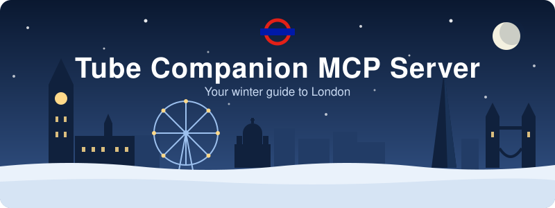

A London Tube [MCP](https://modelcontextprotocol.io) server and a minimal client. Check line status, plan journeys, translate Cockney slang and manage an Oyster card.

```
mcp-lab/
├── server/   MCP server (Express, Streamable HTTP)
└── client/   Minimal MCP client
```

## Prerequisites

- **Node.js 22.12 or newer** (22 LTS). Check with `node -v`.
- **A public URL**: use either [GitHub Codespaces](https://github.com/features/codespaces) (port 8080 set to Public) or a [`cloudflared`](https://developers.cloudflare.com/cloudflare-one/connections/connect-networks/downloads/) tunnel.

## Run

```sh
npm install                # installs both workspaces
npm run dev                # starts the server and an interactive client; type quit to stop both
PORT=9090 npm run dev      # same, on another port (default 8080)
```

In the client prompt:

```
mcp> tools
mcp> call line_status {"line":"Jubilee"}
mcp> call oyster_balance
mcp> quit
```

Or run them separately, in two terminals:

```sh
npm run server             # http://localhost:8080/mcp  (PORT=9090 npm run server for another port)
npm run client             # MCP_URL=http://localhost:9090/mcp MCP_TOKEN=<token> npm run client
```

## Test

```sh
npm test
```
